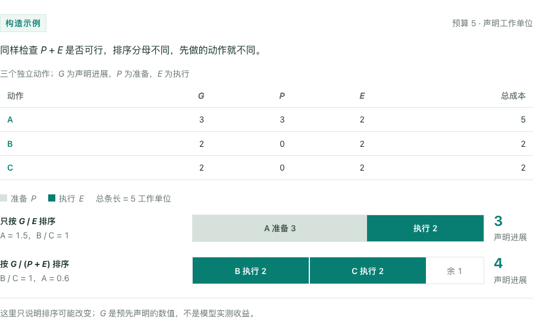
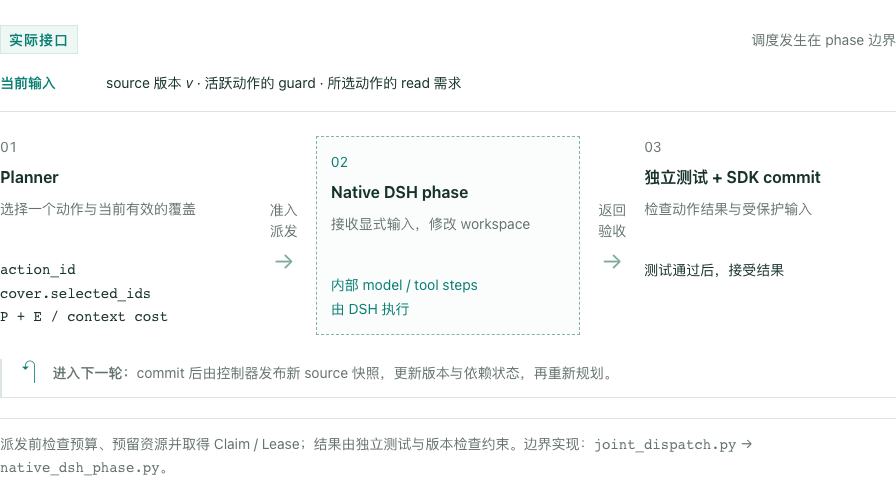
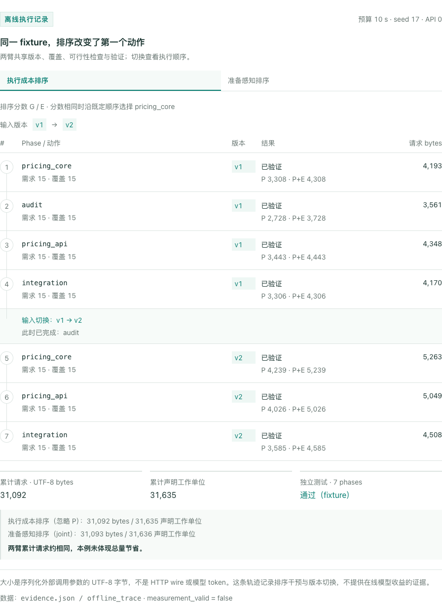
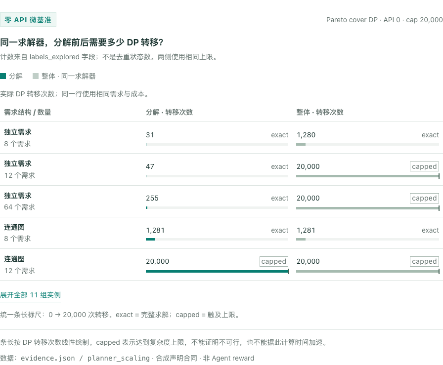

# LongHorizonOS：把上下文准备成本纳入执行调度

一个长程 Agent 完成一步工作之前，往往还要读取材料、恢复上下文，或重验已经过期的结论。这些准备也消耗预算，并且因下一步选什么而不同。

**LongHorizonOS 研究：在相同信息和预算下，把状态准备成本纳入动作选择，能否获得更多经验证的任务进展？** 本文展示已接通的运行时、可复现的离线轨迹和局部求解器优化。真实模型收益仍待实验检验。

## 准备成本会改变执行次序

考虑三个独立动作。A 的声明进展较高，但需要额外准备；B、C 的材料已可用。即使两种策略都检查总预算，忽略准备成本的排序也可能先耗尽预算。

图 1｜构造示例，所有数字均为声明单位。相同预算、相同可行性检查，仅排序不同。它说明一种错选可能，不是真实 reward 结果；该启发式也有更差的反例，见复现材料。

我们比较执行成本排序 `G/E` 与准备感知排序 `G/(P+E)`。G 是声明进展，P、E 是同单位的准备与执行估计。上下文容量、完整请求大小和资源准入仍分别检查。这个规则只看当前一步，不保证长程全局最优。

## 一次决策实际控制什么

输入是当前版本、活跃需求和可用材料；输出同时绑定**执行哪个动作、交付哪些材料、预留多少预算**。Graph 维护显式依赖，持久状态保留来源，context 承载本轮输入。

图 2｜候选实现的实际路径。控制边界是一个 native DSH phase，内部可以包含多次模型与工具调用；不是逐次接管内部工具。

OS 的职责落在版本生命周期、资源准入、执行所有权与结果提交上。结果经过独立测试和版本检查后才推进状态；中断保留成本与未决请求。语义依赖由应用合同声明，内部 shell 读写仍有明确标记的不可见范围。

## 从日志检查干预是否生效

下图来自相同初始材料的真实离线控制运行：使用合成候选与测试结果，不调用模型。两种排序选择了不同的首步；v1 完成后，合同切换到 v2，三条受影响任务重新执行，audit 保留。

图 3｜可切换查看两臂。数字来自已保存的计划与账本；请求大小是 UTF-8 字节，不是 token。18/18 离线试次完成，真实效果对数为 0。

两臂七步累计请求分别为 31,092 与 31,093 字节，基本相同。首步选择变了，累计请求并未节省；这条记录支持控制路径已运行，尚不能证明更长程的上下文复用收益。

## 图结构减少规划中的重复工作

材料覆盖求解器先拆分独立的“需求—表示”子图，各自求解后合并 Pareto 前沿。共享表示会连接子图；不能拆分的实例仍保留原来的最坏情况。

图 4｜相同输入、相同求解器、相同 20,000 次转移上限。可解实例核对覆盖与成本一致；触及上限表示未解，不能当作加速倍数。包含连通实例作为边界对照。

8 个独立需求下，转移计数从 1,280 降到 31；连通的 8 需求实例两者都是 1,281。分解是经典算法手段，这里报告工程效果，不将它包装成原创算法或模型收益。

## 真实实验需要回答什么

已准备的 coding pilot 使用两种排序、300/900/1800 秒预算，各重复三次，共 18 个试次。两臂共享版本、材料覆盖、可行性检查和独立测试，只改变准备成本是否参与排序。

需要判断的是：把控制、准备、重验、失败和所有调用计入之后，reward、耗时与完整 token 的权衡是否改善。P 目前是声明代理量，尚未校准为真实时间或 token；该对照也不能代表所有 checkpoint 或检索系统。

AI4AI 的持续代码与实验迭代，是这种运行时的一个应用场景。跨工作流收益、前瞻调度和自动识别全部语义依赖，都需要额外证据。

[实现与实验口径](implementation-notes.md) · [原始证据](assets/evidence.json) · [微基准 CSV](assets/planner-scaling.csv) · [核算示例复现](assets/verify_example.py)

写作与问题组织参考：[Reactive Optimizers](https://xingjianbai.com/reactive-optimizers/) 与 [ResearchBoost](https://ydove0324.github.io/hx_resume/blog/researchboost/)。项目：[LongHorizonOS](https://github.com/Yang-Jiashu/LongHorizonOS)。
