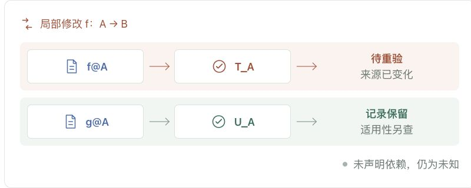
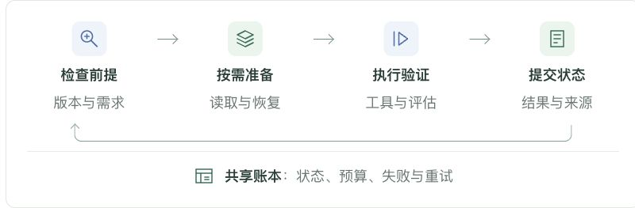
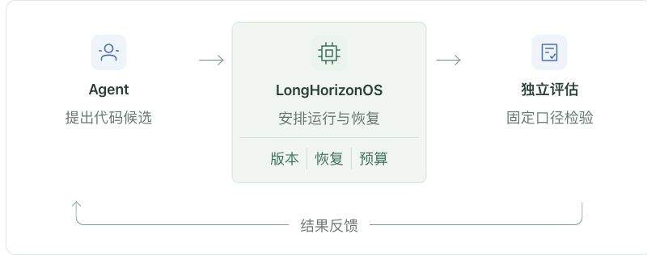

# LongHorizonOS 面向自我改进 Agent 的运行时

Agent 在版本 A 上测得“测试通过”，修改代码得到 B，换一次上下文后继续工作。**旧结论还能用吗？哪些需要重验，哪些可以保留？**

LongHorizonOS 连接长期任务的状态、依据与资源，让后续行动能够检查自己的前提。

## 结论需要适用条件

图 1｜设计示意：来源变化后，相关证据待重验，历史记录仍保留。

“测试通过”应关联来源版本、配置和验证器。只保留一句摘要，容易丢失这些条件；每次重读全部历史，又会增加成本。

目标是用图表达已声明依赖。来源变化后，区分受影响、条件未变与未知的结果，再准备下一步需要的信息。**图维护已知关系，不自动证明语义正确。** 未知仍需重新查证。

## 让恢复参与调度

缺少依据时，可以读取当前来源、重新验证，或恢复满足条件的历史结果。选择需要同时考虑准备成本和剩余预算，恢复之后还要留出有用执行的时间。

原始日志负责追溯，状态图表达依赖，当前上下文承载选取的工作信息。压缩、驻留与重读需要一起权衡；额外维护、失败和重试的成本也要记账。

图 2｜目标闭环：检查、准备、执行与提交；失败同样计入成本。

## 为 AI4AI 提供运行基础

[ResearchBoost](https://ydove0324.github.io/hx_resume/blog/researchboost/) 用可靠反馈推进训练代码优化，[Darwin Gödel Machine](https://arxiv.org/abs/2505.22954) 探索 Agent 的代码自修改。

LongHorizonOS 希望支撑这样的多轮过程：模型提出候选，运行时维护版本、执行和预算，独立评估器判断效果。评价条件发生变化，也应有明确记录，避免把不可比较的分数当成改进。

图 3｜目标分工：Agent 提出候选，运行时管理执行，独立评估器判断效果。

## 当前基础与验证目标

当前代码已有显式依赖与版本状态、部分恢复和资源核算。动态需求与统一原生闭环仍在完善，尚不能宣称统一的 reward 或 token 收益。

接下来要验证：局部变化是否引起了可避免的大量重验与恢复？在相同信息和预算下，是否优于普通版本管理、checkpoint 和检索？完整比较需要计入 reward、时间、未缓存输入、缓存读取、输出及失败成本。

[ClawVM](https://arxiv.org/abs/2604.10352) 的状态驻留与写回、[PlanFence](https://arxiv.org/abs/2609.03340) 的来源版本检查，是直接相关的基础。LongHorizonOS 将在此基础上检验调度的净收益。

项目：[LongHorizonOS](https://github.com/Yang-Jiashu/LongHorizonOS)
